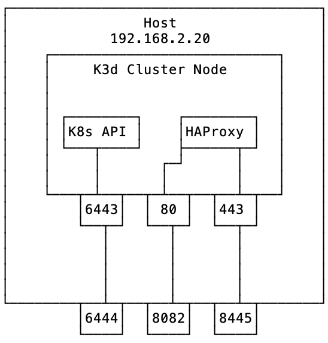

# K8s Learning Template

# Getting Started with the Template

This repo is a template to duplicate when exploring a new K8s based project / application.

## Prerequisites to Get Started

- Git installed on your local machine
- SSH key configured with your Git server (GitHub, GitLab, etc.)

## Setup Instructions

### 1. Clone the Template Repository
```bash
git clone git@github.com:TheFutonEng/k8s-learning-template.git my-k8s-project
cd my-k8s-project
```

### 2. Remove the Existing Remote
```bash
git remote remove origin
```

### 3. Add Your New Repository as the Remote
```bash
git remote add origin git@github.com:YOUR-USERNAME/YOUR-NEW-REPO-NAME.git
```

### 4. Push the Code to the New Repository
```bash
git push -u origin main
```

### 5. Verify the Remote Configuration
```bash
git remote -v
```

# Repositor Dependencies

This repo requires the following tools:

- `just` (tested with 1.36.0)
- `k3d` (tested with 5.8.1)
- `yq` (tested with v4.44.5)
- `go` (tested with 1.24.2)

A quick way to take care of `just` and `go` if the [`asdf`](https://asdf-vm.com/) version manager is in use on a system is to run the `setup-tools.sh` script:

```bash
$ ./setup-tools.sh
Checking required tools.
Installing just version 1.36.0.
just 1.36.0 is already installed
just 1.36.0 is ready
Installing golang version 1.24.2.
golang 1.24.2 is already installed
golang 1.24.2 is ready
All required tools are installed and configured!
```

`k3d` and `yq` need to be installed via other means.

# K3d Cluster Templater

This tool quickly creates K3d cluster configurations with automated port allocation and customizable parameters.

## Features
- Automatically finds available ports for API server, HTTP, and HTTPS
- Template-based configuration generation
- Customizable server and agent counts, CPU, and memory allocations

## Installation
```bash
go build -o k3d-templater k3d-templater.go
```

Alternatively, call the `compile-templater` target:

```bash
just compile-templater
```

## Usage

Basic usage (required cluster name):

``` bash
./k3d-templater -name my-project
```

All available options:

```bash
./k3d-templater -name my-project -domain local -servers 2 -agents 3 -memory 2gb -cpu 2 -template custom-template.yaml -output my-config.yaml
```

## Parameters

| Flag | Description | Default |
| ---- | ----------- | ------- |
| `-name` |	Cluster name (required)	| none |
| `-servers` |	Number of K3d servers	| 1 |
| `-agents`	| Number of K3d agents | 0 |
| `-memory` |	Memory allocation for servers	| "1gb" |
| `-cpu` | CPU allocation for servers | "1" |
| `-template` |	Path to template file	| "k3d-template.yaml" |
| `-domain` | Domain for wildcard certificate| "local"|
| `-cert-template` | Path to certificate template file| "k8s/certificate-template.yaml"
| `-cert-output` | Certificate output file path | "k8s/certificate.yaml" |
| `-output` |	Output file path | "k3d-config.yaml" |

## Integration with `just`
Add this to your justfile to easily create and start clusters:

```bash
# Create a new K3d cluster configuration
create-cluster NAME SERVERS="1" AGENTS="0" MEMORY="1gb" CPU="1":
    ./k3d-templater -name {{NAME}} -servers {{SERVERS}} -agents {{AGENTS}} -memory {{MEMORY}} -cpu {{CPU}}
    k3d cluster create --config k3d-{{NAME}}.yaml

# Delete a K3d cluster
delete-cluster NAME:
    k3d cluster delete {{NAME}}
```

### Example

```bash
./k3d-templater -name webapp -servers 2 -memory 2gb
k3d cluster create --config k3d-webapp.yaml
```

## `just` Targets

```bash
$ just
Available recipes:
    compile-templater          # Compile k3d-templater
    create-cluster-config NAME # Create a new K3d cluster configuration
    create-custom-cluster-config NAME SERVERS="2" AGENTS="1" MEMORY="2gb" CPU="2" # Create a K3d cluster with custom configuration
    default                    # List available recipes
    delete-ca-integration      # Delete step-issuer
    delete-cert-manager        # Delete cert-manager
    delete-cluster             # Delete k3d cluster and clean up resources
    delete-ingress             # Clean up HAProxy
    delete-step-issuer         # Delete step-issuer
    delete-wildcard-cert       # Create wildcard certificate for *.wsp.local
    deploy-cert-manager        # Deploy cert-manager
    deploy-cluster             # Create k3d cluster using configuration file
    deploy-ingress             # Deploy HAProxy ingress controller
    deploy-step-issuer         # Deploy step-issuer
    deploy-wildcard-cert       # Create wildcard certificate for *.wsp.local
    reset-all NAME             # Reset everything and create a fresh cluster with all components
    setup-ca-integration       # Setup CA integration with step-issuer
```

As noted above, there are a lot of components that get deployed as part of the template.  This is to integrate with the created cluster with the PKI infrastructure of my home lab.  If someone else is consuming this template, it will need to be updated to accommodate your PKI infrastructure.  For a `step-ca` specific example, see the `step-ca-integration-example.yaml` file for details on what needs to be provided.  Once filled out, rename that file to `step-ca-integration-values.yaml` and run `just reset-all`.  The `step-ca-integration-values.yaml` file is present in `.gitignore` so sensitive data isn't accidentally pushed to a git server.

# Ingress Details

This template assumes the following:

- A user may wish to have multiple of these templates running for different applications on the same host.
- A user may be running these clusters on a remote host.

With the above points in mind, the approach taken for ingress is to deploy HAProxy as a [`daemonSet`](https://kubernetes.io/docs/concepts/workloads/controllers/daemonset/) and bind ports `80` and `443` on the K3d nodes to different ports on the host.  These ports are selected dynamically and are output when calling the `create-cluster-config` or `reset-all` targets:

```bash
$ just create-cluster-config neuvector
go build -o k3d-templater ./go/k3d-templater.go
./k3d-templater -name neuvector -domain local
Created K3d configuration file: k3d/k3d-config.yaml
API Port: 6444
HTTP Port: 8082
HTTPS Port: 8445
Created certificate configuration file: k8s/certificate.yaml
Certificate CommonName and DnsName: *.local
```

In the above example, the Kubernetes API port to target for the cluster is `6444`, the HTTP port is `8082`, and the HTTPS port is `8445`.  These are set dynamically based on what is already in use.  Below is a quick and dirty diagram of the port layout:




What this means is that the ports in the above output are what a user would target to hit the Kubernetes API, in cluster HTTP resources, or in cluster HTTPS resources respectfully from wherever they were operating.

## Update /etc/hosts

Whether or not this is a remote or local cluster, the localhosts file on the workstation needs to be updated to bind the service name to an IP address. Using the output and diagram from the previous example, a binding for `neuvector.local` to `192.168.2.20` is needed.

> I do not have a Windows machine available to test with so the below instructions are only valid for Linux and MacOS.

Ensure the below entry is present in `/etc/hosts`:

```bash
192.168.2.20 neuvector.local
```

Now the name `neuvector.local` will be resolvable:

```bash
$ ping neuvector.local
PING neuvector.local (192.168.2.20): 56 data bytes
64 bytes from neuvector.local: icmp_seq=0 ttl=64 time=0.791 ms
64 bytes from neuvector.local: icmp_seq=1 ttl=64 time=0.819 ms
^C
--- neuvector.local ping statistics ---
2 packets transmitted, 2 packets received, 0.0% packet loss
round-trip min/avg/max/stddev = 0.791/0.805/0.819/0.014 ms
```

# Certificate / PKI Details

To support any applicaiton that can run in Kubernetes with a web front end, this template produces a setup whereby a [wildcard certificate](https://www.digicert.com/faq/public-trust-and-certificates/what-is-a-wildcard-certificate) is put in place on the [HAProxy ingress controller](https://www.haproxy.com/documentation/kubernetes-ingress/). In this configuration, HAProxy is terminating TLS and the connection to the